# Architecture & System Diagram

This document is written for two audiences:

- **Developers** who need the exact data-flow, module boundaries and contracts.
- **Non-technical readers** who want to understand how the game is put
  together without reading code.

The short version: **KOTODAMA is a data-driven simulation.** All content —
regions, chapters, bosses, quests, dialogue, weapons, codex entries, endings —
is data. The engine is a set of small systems that interpret that data.
The world is deterministic: same seed, same world, every time.

---

## 1. The one-paragraph explanation

You press **New Game**. The bootstrap (`main.ts`) creates a canvas, a `Game`
orchestrator, and the UI shell. The orchestrator reads the **save data**
(which chapter, which region, which weapons), then asks the **World** to
build the current region out of terrain, landmarks, people, shrines and
collectibles — all generated procedurally from data. Every frame, a loop:

1. reads your input (keyboard/mouse/touch),
2. steps the player physics + combat state,
3. steps every enemy's AI and attacks,
4. resolves hits, projectiles, hazards and effects,
5. updates camera, weather, audio and the HUD,
6. asks the renderer to draw the frame.

When you talk to an NPC, the **Dialogue** system reads a tree from data,
shows lines and choices, and applies their effects (flags, items, quests).
Quests are a lightweight state machine over world events (talk, kill,
collect, reach, boss, flags, choices). Everything is saved to `localStorage`
through the SaveSystem.

---

## 2. System diagram (SVG)

The full diagram ships as a standalone HTML file you can open in any browser:
**[`system-diagram.html`](system-diagram.html)** — it includes both a
zoomable SVG and a plain-text transcript for screen readers.

A static SVG thumbnail is also available at
[`assets/architecture.svg`](assets/architecture.svg).

---

## 3. Mermaid version (for GitHub/Notion)

```mermaid
flowchart TB
  subgraph Boot
    main["main.ts"]
    ui["UI (DOM)"]
    game["Game orchestrator"]
  end

  subgraph Systems
    input["Input"]
    player["Player"]
    ai["Enemy AI"]
    world["World (landmarks/NPC/shrines)"]
    terrain["Terrain"]
    weather["Weather"]
    fx["Effects (sparks/trails/AoE)"]
    cam["CameraRig"]
    audio["AudioEngine (synthesis)"]
    q["QuestSystem"]
    dlg["Dialogue"]
    save["SaveSystem"]
    ach["Achievements"]
    codex["Codex"]
    endgame["Endings"]
    ngp["New Game +"]
  end

  subgraph ContentData
    regions["regions.ts"]
    chapters["chapters.ts"]
    enemies["enemies.ts"]
    quests["quests.ts"]
    dialogue["dialogue.ts"]
    weapons["weapons.ts"]
    cinematics["cinematics.ts"]
    codexdata["codex.ts"]
    endingsdata["endings.ts"]
    achdata["achievements.ts"]
  end

  main --> game
  game --> ui
  ui --> game

  game --> input
  game --> player
  game --> ai
  game --> world
  game --> terrain
  game --> weather
  game --> fx
  game --> cam
  game --> audio
  game --> q
  game --> dlg
  game --> save
  game --> ach
  game --> codex
  game --> endgame
  game --> ngp

  world --> terrain
  world --> regions
  player --> weapons
  ai --> enemies
  q --> quests
  q --> save
  dlg --> dialogue
  dlg --> save
  ach --> achdata
  ach --> save
  codex --> codexdata
  endgame --> endingsdata
  endgame --> save
  ngp --> save
  save -->|writes| localStorage[(localStorage)]
```



---

## 4. The important contracts

### 4.1 Save data — `src/types.ts` → `SaveData`

The save is a plain JSON object: chapter, region, spawn, position, stats,
weapon, unlocked weapons, skills, inventory, flags, quest states, codex,
achievements, discovered shrines, visited regions, deaths/parries/kills,
ending, NG+ count, checkpoint. **Flags are the world's memory**: quests,
endings, secrets, achievements and dialogue all key off them.

- Save slots: 1–3 manual + slot 0 autosave.
- `SaveSystem` is validated, versioned and migration-safe
  (`migrateSave`). It is DOM-free and fully unit-tested.

### 4.2 Content is data — `src/content/*`

| File | What lives there |
| --- | --- |
| `regions.ts` | 6 regions: theme, terrain config, landmarks, shrines, NPCs, enemy spawns, collectibles, secrets, arenas, spawn points, map meta |
| `chapters.ts` | prologue + 10 chapters, each → region + spawn + boss + intro/outro cinema + rewards |
| `enemies.ts` | 15 base enemies + 6 elites + 10 bosses (phases, moves, barks, auras) |
| `quests.ts` | 11 main + 12 side quests, staged walkthroughs, rewards, ending weights |
| `dialogue.ts` | 19 dialogue trees with flags, choices, effects |
| `weapons.ts` | 5 weapons, movesets, 5 + 1 arts, items, skills (3 trees) |
| `cinematics.ts` | timeline-based cutscenes (camera, lines, titles, fades) |
| `codex.ts` | 65 entries |
| `achievements.ts` | 35 achievements |
| `endings.ts` | 4 endings + evaluator |

### 4.3 The frame loop — `Game.loop`

```
requestAnimationFrame
  ├─ clamp dt (≤50ms) × gameSpeed
  ├─ update engine/effects/world/weather (ambient motion)
  ├─ if playing:
  │    ├─ input look → camera
  │    ├─ global keys (pause/photo/journal/map/skills/codex/item/weapon)
  │    ├─ lock-on acquire/clear
  │    ├─ player.update(dt, input, camera, terrain)
  │    ├─ obstacle resolve
  │    ├─ camera.update
  │    ├─ player combat vs enemies (hit windows, arcs)
  │    ├─ deathblow check
  │    ├─ enemy updates + postUpdate (boss phases/auras)
  │    ├─ projectiles/hazards vs player
  │    ├─ interaction prompt + activate
  │    ├─ boss arena triggers
  │    ├─ HUD refresh
  │    └─ autosave heartbeat (75 s)
  ├─ dialogue / cinematic steppers (mode-dependent)
  ├─ ui.tick(dt), input.endFrame()
  └─ engine.render()
```

### 4.4 Mode machine

`boot → title → playing ⇄ paused` with transient `dialogue`, `cinematic`,
`dead`, `photo`, `ending`, `credits`. Input is only interpreted in `playing`;
menus are driven by the UI; the loop keeps rendering everything.

### 4.5 Determinism

Terrain, flora, rocks, village layouts, bamboo clusters and arena layouts are
all seeded from region seeds (`SeededRandom` over `mulberry32`). Two players on
the same build see the same world. RNG used for *behavior* (enemy decisions,
spark directions) is intentionally unseeded so fights feel alive.

---

## 5. Data flow, end to end

**Example: "Talk to Ame → accept lantern quest → collect 3 memories → complete"**

1. `Input` delivers `interact` while the `World` nearest-interaction query
   reports NPC `ame` within range.
2. `Game.activateInteraction` → `quests.onTalk('ame')` (advances the
   prologue main quest) then `openDialogue(ame_shore)`.
3. `QuestSystem` advances `mq_prologue` (stage `talk_ame`);
   `game` applies its reward via `grant`.
4. The dialogue shows lines; the player picks a choice with effects:
   `quest sq_lantern start` + flag `met_ame`.
5. `QuestSystem.start('sq_lantern')` sets `acceptFlags` and the quest state.
6. Later, touching a memory collectible:
   `World.takeCollectible` → `Game` sets `collectible_<id>`,
   `quests.onCollect('memory_fragment')`, unlocks codex, toasts.
7. On the third fragment the quest advances to `talk ame`; talking again
   completes it: rewards granted, `completeFlags` set,
   `quest:complete` event → toast + achievements check.
8. `SaveSystem` autosaves on the heartbeat and at key moments.

**Example: "Boss fight"**

1. `World.checkArenaTriggers` fires when the player crosses the arena radius
   for the current chapter's arena (and `boss_<id>` isn't already set).
2. Game spawns the boss, sets arena leash on boss + player, swaps music to
   `boss` mood, tints arena fog, shows the boss bar.
3. Enemy AI is a state machine: notice → approach → telegraph → strike →
   recover; attacks expose windup/active/recover so parries are learnable.
4. Posture break → `deathblow` → boss takes 16% max HP.
5. On death: flags `boss_<id>`, quest `boss` stage completes, outro cinema
   plays, then the next chapter is loaded from data.

---

## 6. Performance notes

- One `EffectComposer` with a single bloom pass; renderer pixel-ratio capped
  per quality tier.
- Terrain: one indexed mesh w/ vertex colors; grass/flora/rocks are
  instanced (a handful of draw calls).
- Weather: one `Points` draw call per region; effects are pooled and capped
  (projectiles 48, hazards 18, bursts 36, timed 120).
- Materials are cached by key (`toonMat`); outlines are baked backside
  meshes, globally toggleable (Kurosawa / accessibility).
- Quality settings: low/medium/high/ultra control pixel ratio, shadows,
  bloom and post.

---

## 7. Testing

`src/tests/` (Vitest, node env, 41 tests):

- **content.integrity** — every cross-reference in content data resolves
  (chapters→regions/bosses, quests→NPCs/landmarks/enemies, dialogue→nodes,
  weapons→moves/arts, achievements→bosses, codex, cinematics).
- **save** — SaveSystem round-trips, migration, slots, settings clamps.
- **combat** — damage math, guard/parry/perilous, dodge i-frames,
  difficulty multipliers, posture, death/respawn, gourd, weapon switch,
  math utils, QuestSystem state machine, true-ending gate.

CI runs `npm run check` (typecheck → tests → production build). See
[`OPERATIONS.md`](OPERATIONS.md).
